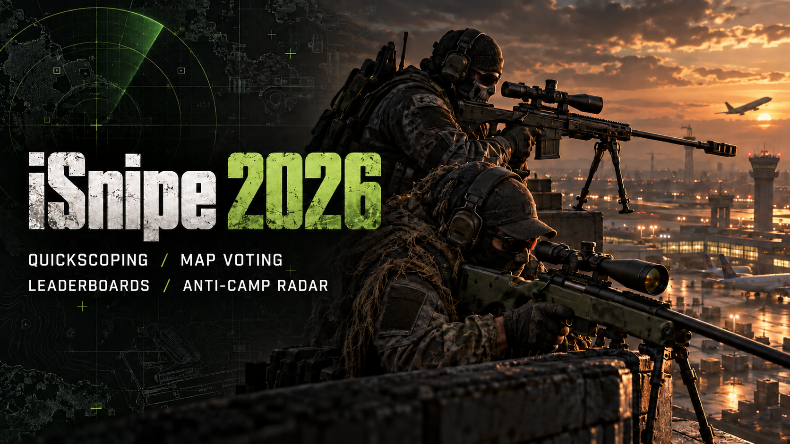

# iSnipe 2026 for IW4x

A custom iSnipe-inspired server setup for the original Call of Duty: Modern Warfare 2 (2009) and IW4x. Includes S&D, Team Deathmatch and Free-for-All variants, two sniper classes (Intervention and M40A3), map voting, a persistent per-server leaderboard (`!lb`, `!leaderboard`, `!top10`), anti-camp radar, killfeed, configurable announcements, and an optional LAN administration panel.

## Requirements

- A legitimate MW2 (2009) multiplayer installation and the IW4x launcher/rawfiles, set up as described in the [IW4x server-hosting guide](https://docs.iw4x.io/hosting/server-hosting/).
- Windows x86-compatible IW4x r4930 environment. `install/iw4x.dll` is a custom build based on upstream r4930 commit `67cd11ad5dc5a93b32a1903665706a847fcde33c`. Keep a backup of your existing DLL. An IW4x update can replace it.
- Python 3.10+ for the control panel and its credential setup. The game servers do not require the panel to be running.
- For Internet play, forward each server's UDP game port and TCP mod-download port to the host. The game installation, commercial game assets, and IW4x launcher are not provided here.

## Why a custom IW4x DLL is included

The iSnipe GSC scripts call native functions added to the supplied `iw4x.dll` and depend on a few server-engine changes that stock IW4x r4930 does not provide. Without this DLL, scripts that call the added functions can fail, and features such as unlimited sprint, the custom killfeed, announcements, and panel player controls will not work as intended. This is a **dedicated-server build** based on the revision listed above; players still need a compatible IW4x client and download the mod assets normally. The DLL does not enable `sv_cheats` globally.

The custom build provides:

- **Unlimited sprint:** `ISnipeGrantMarathon` sets the replicated Marathon perk effect without replacing an ordinary perk slot. It also permits the host to configure `player_sprintUnlimited` on a dedicated server without enabling cheat mode; the supplied setup uses the Marathon effect.
- **Killfeed support:** a server-side obituary hook suppresses the stock killfeed event when the custom feed is enabled. `ISnipeWeaponKillIcon` looks up the weapon's real kill icon for the script-driven feed. When the custom feed is disabled, the stock obituary path remains available.
- **Announcements:** `ISnipeLocalMinute` supplies the host's local date and time to the scheduler, while `ISnipeAnnounceAll` and `ISnipeAnnouncePlayer` deliver server-wide and individual chat messages. The GSC script handles scheduling and welcome-message timing.
- **Control-panel integration:** `isnipePanelPlayers`, `isnipePanelKick`, `isnipePanelBan`, and `isnipePanelSay` are dedicated-server RCON commands. Moderation commands validate the player's slot, GUID, and current connection identity before acting, reducing the risk of targeting a replacement player after a slot is reused.
- **Diagnostics and legacy radar support:** `ISnipeLogWeaponAccuracy` logs selected weapon spread and sway values. `ISnipeSetCompassPing` is a legacy firing-event ping used by the fallback radar path; it can produce firing effects. The normal configured anti-camp radar overlay is implemented by the mod scripts and assets, rather than this legacy function.

Map voting, the leaderboard, loadouts, anti-camp position checks, and most match rules are implemented in the bundled GSC scripts, configurations, and assets; they are not all DLL features. The exact changes are available in [`source/iw4x-r4930-isnipe.patch`](source/iw4x-r4930-isnipe.patch), with build instructions and limits in [`docs/BUILD.md`](docs/BUILD.md). Replacing the DLL with a stock or different-revision build requires compatibility work and testing.

## Install

1. Back up your existing `iw4x.dll`, settings and mod folders. Stop the game servers. Copy the **contents** of `install/` into your IW4x game root, the folder containing `iw4x.exe`. This installs the custom DLL, three mod folders, example configurations, panel and launchers.
2. Run `python Initialize-iSnipe-Control.py` from the game root. It generates a unique admin password and RCON secret; it refuses to overwrite existing panel credentials. The game configurations load the generated `userraw/isnipe-panel-rcon.cfg`. Even if you do not use the panel, this creates the referenced config.
3. Review `userraw/isnipe-dev.cfg`, `isnipe-tdm.cfg`, `isnipe-ffa.cfg`, `isnipe-public.cfg`, and `isnipe-announcements.cfg`. Change names and options to suit your server. The default map-vote pool includes optional maps: install and verify maps before offering them to players. Test bots are disabled.
4. Start the modes using `Start-iSnipe-SD-Public.bat`, `Start-iSnipe-TDM-Public.bat`, and `Start-iSnipe-FFA-Public.bat`, or use the control panel. Defaults: S&D UDP/TCP 28960 (first to 5 rounds, 10-minute rounds), TDM 28961 (15 minutes, 75 kills), and FFA 28962 (15 minutes, 50 kills). UAV and Counter-UAV are configured at 3 and 4 kills; TDM and FFA also offer a nuke at 25.
5. From an outside network, test game connections and client mod downloads. Refresh the IW4x server browser; listing also depends on the IW4x discovery service.

### LAN control panel

Run `Start-iSnipe-Control.bat`, then visit `http://HOST-LAN-IP:8787/` on a trusted LAN. The initial username and generated password are in `iSnipe-Control/panel-password.txt`. Change the password under Security. The panel can start, stop and restart the three instances; send announcements; configure welcome, repeated and daily announcements; kick or ban connected players; manage the shared ban list; and change basic match settings. Settings require a game-server restart where indicated.

The panel uses unencrypted HTTP and is intended for a trusted LAN. Do not forward port 8787 to the Internet. Game RCON is restricted to localhost by the generated config. Bans add both an IP and a GUID; remove both entries to completely unban someone. Never publish `panel-settings.json`, `panel-password.txt`, `isnipe-panel-rcon.cfg`, player logs, or ban data.

## Source and rebuilding

- `install/mods/`: current server GSC, voting scripts, compiled mod fastfiles and UI packages. Each game mode has its own folder and leaderboard data at runtime.
- `source/iw4x-r4930-isnipe.patch`: changes to the IW4x r4930 client/dedicated source, including sprint/perk handling, killfeed support, announcements, panel commands and a legacy radar ping. `docs/BUILD.md` has build steps.
- `source/asset-build/`: weapon/preview definitions and zone manifest used for the current fastfile; `source/menus/` contains menu source. Building fastfiles requires the applicable IW4x tools and game assets. See `docs/BUILD.md` for limitations.
- `source/mapvote/`: source and resources from the imported map-vote package.

## Updating and uninstalling

Back up your configuration, `mods/<mode>/scriptdata/` leaderboard journals, and `userraw/bans.json` before updating. Replace the mod and DLL files only while servers are stopped, preserving your private panel files and settings. Keep the custom DLL aligned with the included GSC and IW4x revision. To uninstall, stop the servers, restore your previous DLL, and remove the installed iSnipe mod folders, launchers, panel and iSnipe configuration files after backing up any data you need.

## Credits and acknowledgments

This recreation builds on work by the IW4x and Call of Duty modding communities. Thank you to the developers and contributors behind these projects:

- **[IW4x contributors](https://github.com/iw4x/iw4x-client)** ? the client, dedicated-server platform, tooling, and source used as the basis for the custom DLL. The [IW4x rawfiles contributors](https://github.com/iw4x/iw4x-rawfiles) also provide game scripts and assets used as references.
- **[iSnipe developers and contributors](https://github.com/isnipe/iSnipe)** ? the original iSnipe project and its gameplay and anti-camp ideas, used as a reference for this recreation.
- **[eztso and the iw4xSniper contributors](https://github.com/eztso/iw4xSniper)** ? the IW4x sniper mod and gametype scripts incorporated into this project. The upstream project also thanks **Santahunter** for code contributions and **tccr** and **raidmax** for IW4x assistance. Its GPL-3.0 license is included in [`LICENSE-iw4xSniper.txt`](LICENSE-iw4xSniper.txt).
- **|UzD|GaZa and fella_guy** ? the original map-vote menu and modified map-vote code, respectively, as credited in the bundled vote scripts. The map-vote update script also credits fella_guy.
- **[Muhlex](https://github.com/Muhlex/iw4x-gsc)** ? IW4x GSC examples consulted for scripting and killstreak behavior.
- **[Blackburn29 and contributors to the MW2 Mod Collection](https://github.com/Blackburn29/MW2-Mod-Collection/tree/master/SnipeMOD)** ? SnipeMOD material consulted as an additional reference.
- **The creators of the IW4x COD4 weapon pack** ? the M40A3 content was derived from the supplied pack. The copy available to this project does not identify its authors, so individual attribution could not be verified.
- **Infinity Ward and Activision** ? the original Modern Warfare 2 game and underlying game assets.

License texts are provided where available; third-party game-derived and map-preview assets retain their respective owners' rights. The supplied fastfile and preview assets originate from the working installation; asset ownership and permission for further redistribution should be checked by the distributor.

## Project status

These files were assembled from a functioning three-server installation. Public connectivity and multiplayer behavior depend on the host, IW4x version, installed maps and clients; they are not guaranteed by a static package check. See `docs/BUILD.md` for known source and validation limits.
